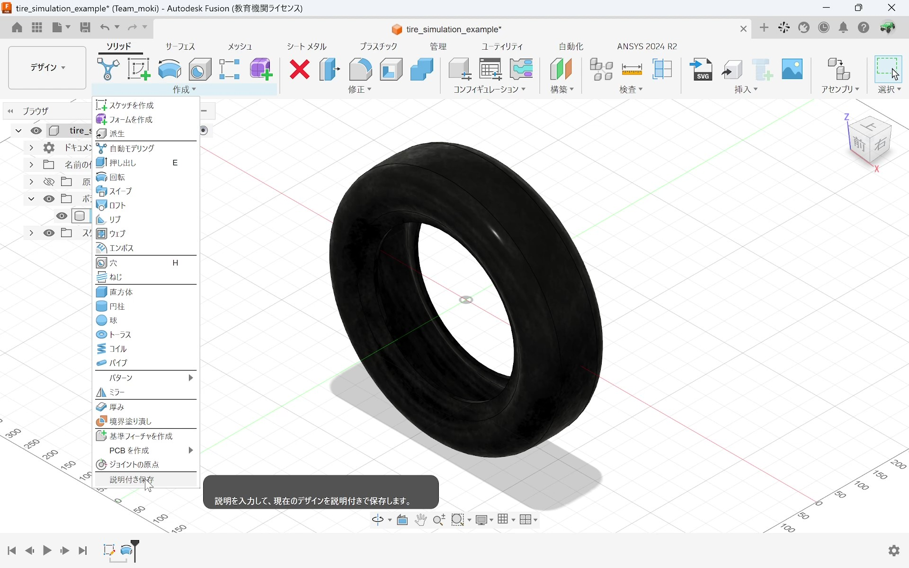
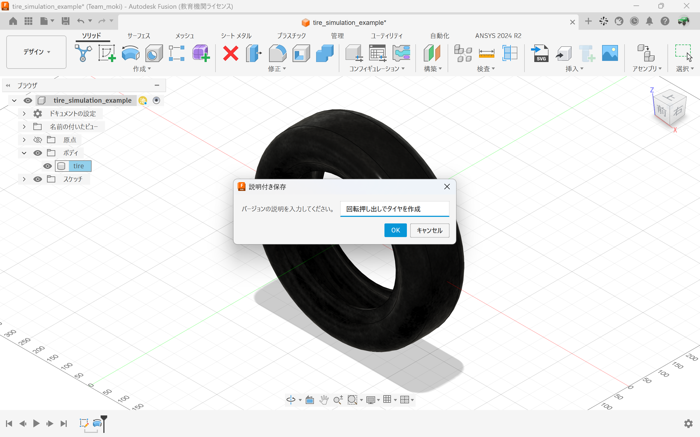
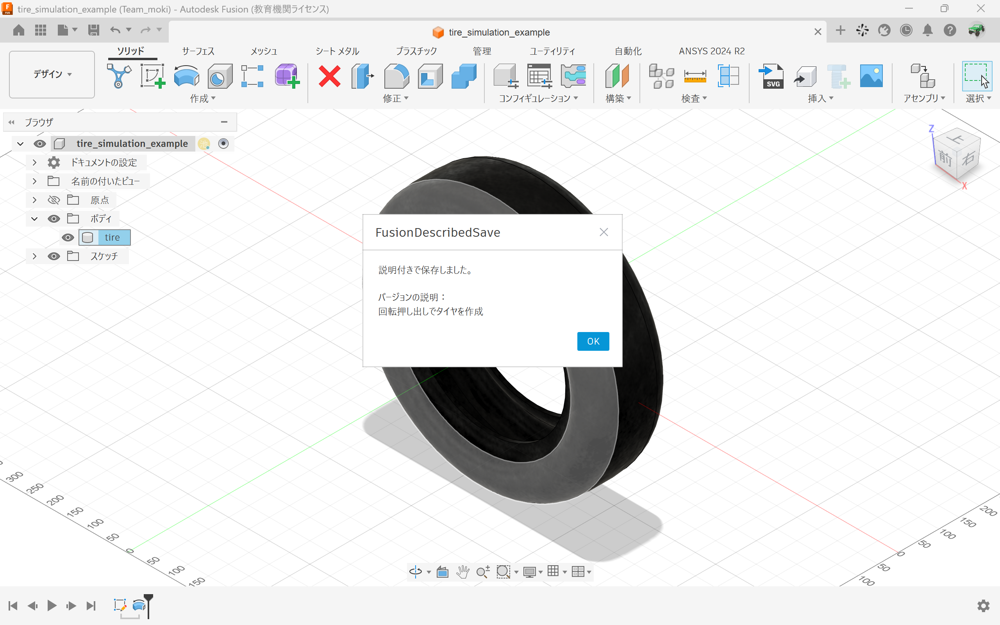
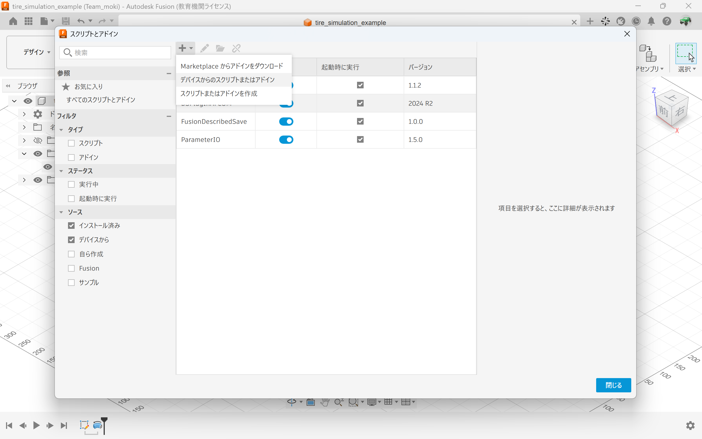

# 拡張機能の概要
　最近のFusionアップデートで、保存時に「バージョンの説明」が出てこなくなり不便に感じでいたので、保存時にバージョンの説明を入力できるAutodesk Fusion用アドインを作りました。

# 特長
* 保存時にバージョンの説明が入力できます。
* 保存が成功したら、完了と確認用のメッセージが表示されます。

# インストール方法
　以下の手順でインストールできます。

1. このGitHubのレポジトリを「Download zip」
2. ダウンロードしたzipを展開
3. Fusionを起動
4. 「Shift + S」でスクリプトのウィンドウを起動
5. 「＋」アイコンで、手順2で展開したzipを選択
6. 「実行」スイッチをONにして、実行するようにします。「起動時に実行」もチェックを入れます
7. 「作成」のタブに移動すると、「説明付き保存」というメニューが表示されるようになります👍

# LICENSE
　This project is licensed under MIT License. See the LICENSE file for details.